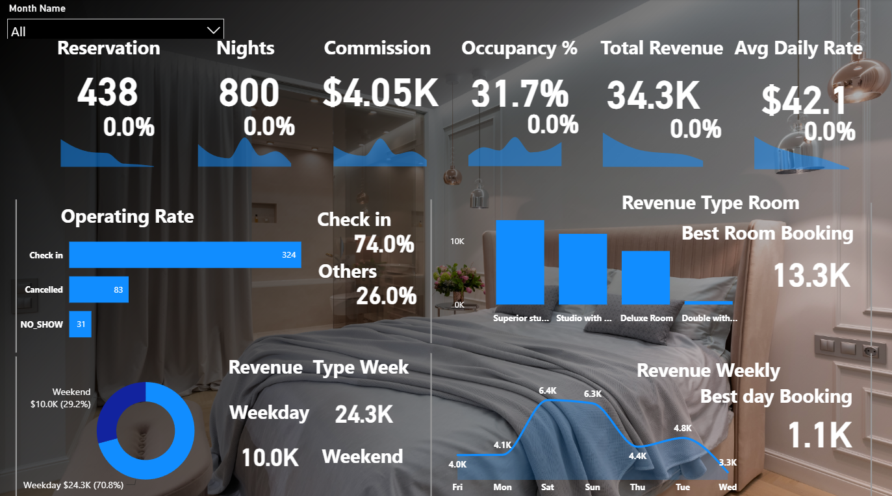
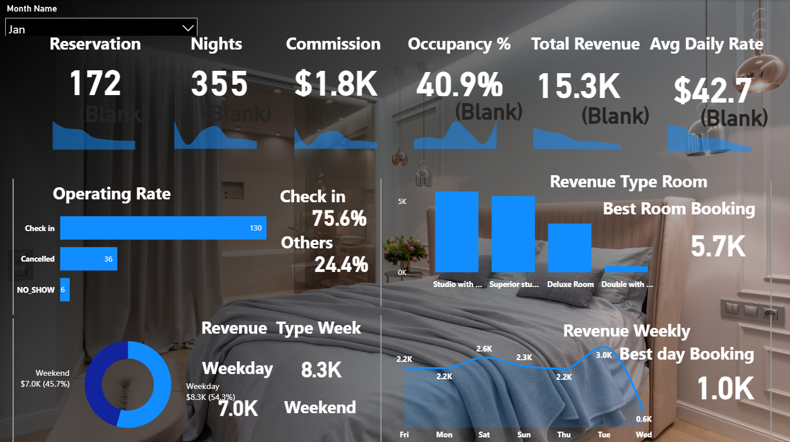
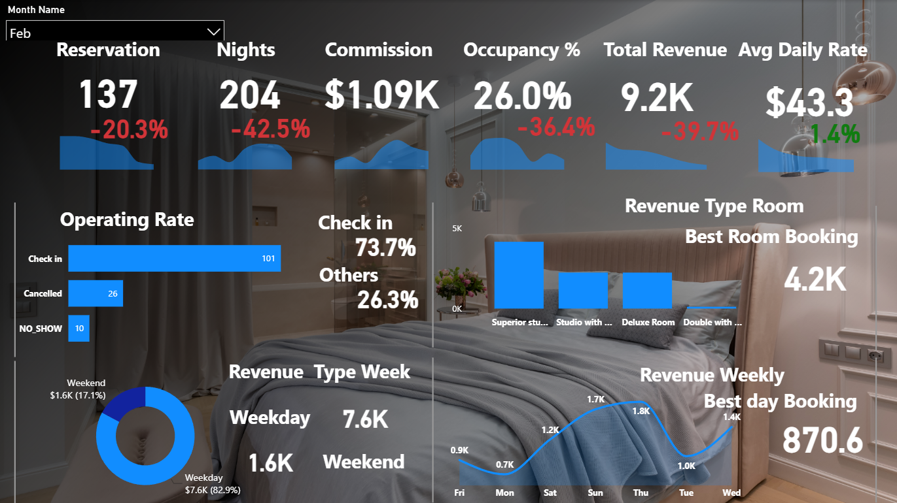
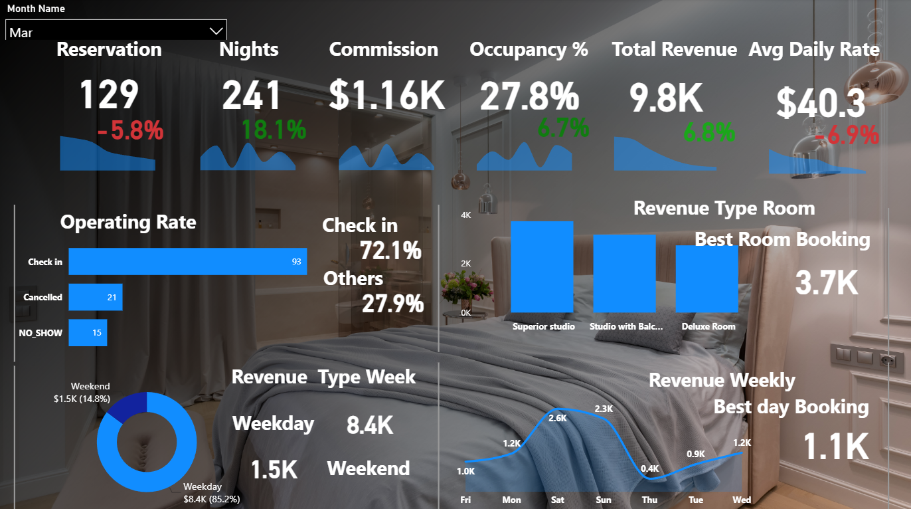
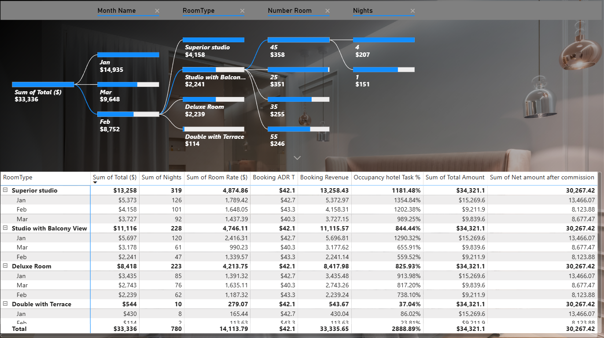

# 🏨 Hospitality & OTA Performance Analytics (Booking.com)

An end-to-end Business Intelligence and Data Analytics project evaluating Q1 operational and financial performance for a hospitality property using Booking.com OTA data. 

---

## 📌 Executive Summary
This project transforms raw reservation and booking logs into an executive-level Power BI dashboard and presentation deck. It tracks core hospitality KPIs (RevPAR, ADR, Occupancy, Length of Stay) and uncovers critical business insights regarding booking leakages, pricing elasticity, and room-type profitability.

---

## 📊 Key Performance Indicators (Q1 Snapshot)
* **Total Gross Revenue:** $34.3K ($30.27K Net Post-Commission)[cite: 7]
* **OTA Commission (Booking.com):** $4.05K (~11.8% effective fee)[cite: 7]
* **Total Volume:** 438 Bookings generating 800 Room Nights[cite: 6]
* **Occupancy & ADR:** 31.7% Overall Occupancy at an Average Daily Rate of $42.1[cite: 6]

---

## 🔍 Key Business Insights & Findings

1. **The 26% Booking Leakage Problem:**
   * Unfulfilled reservations (Cancellations + No-Shows) steadily rose from **24.4%** in January to **27.9%** in March[cite: 8, 9]. 
   * No-shows more than doubled from 6 cases in Jan to 15 cases in March, highlighting an urgent need for pre-arrival payment policies[cite: 8, 10].

2. **Pricing Elasticity & Length of Stay (ALOS):**
   * In February, raising ADR to $43.3 shortened guest stays to 1.49 nights.
   * In March, strategically reducing ADR by **-6.9% to $40.3** unlocked multi-night bookings, lifting the Average Length of Stay by **+25% to 1.87 nights** and recovering revenue to $9.8K.

3. **Room Type Concentration:**
   * **Superior Studio** and **Studio with Balcony View** drove **73%** of total Q1 revenue[cite: 7].
   * The *"Double with Terrace"* category severely underperformed, generating only $544 across 10 nights (and zero bookings in March)[cite: 7, 10].

---

## 📸 Dashboard Previews & Filtering Layers

Here is a preview of the interactive Power BI views across different months and dimensional drill-downs:

* **1. All Months Overview (Q1 Macro View):**
  [cite: 13]

* **2. January View (Peak Performance):**
  [cite: 9]

* **3. February View (Seasonal Contraction):**
  [cite: 11]

* **4. March View (Volume & Length of Stay Recovery):**
  [cite: 10]

* **5. Decomposition Tree & Detailed Room Matrix:**
  [cite: 12]

---

## 📁 Project Deliverables
* **Executive Presentation Deck:** You can view the full 10-slide executive review here: [Q1_Booking_OTA_Performance_Review.pdf](Q1_Booking_OTA_Performance_Review.pdf)[cite: 7]
* **Dashboard Visuals:** High-resolution screenshots of the Power BI reporting layers are stored in the `Dashboard-Screenshots` directory.

---
*Prepared by **Abdallah Rady** | Data Analyst & BI Developer*[cite: 7]
